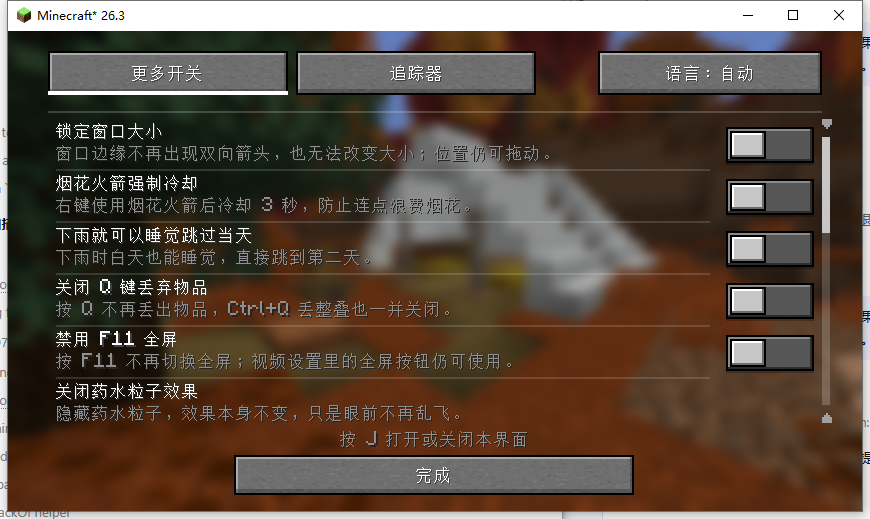
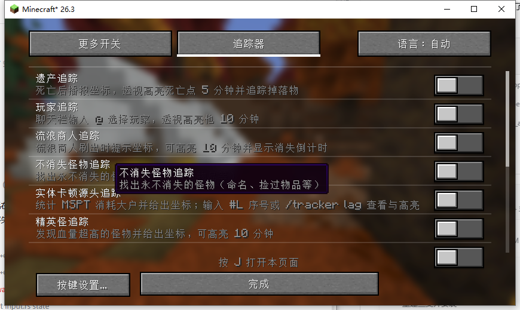
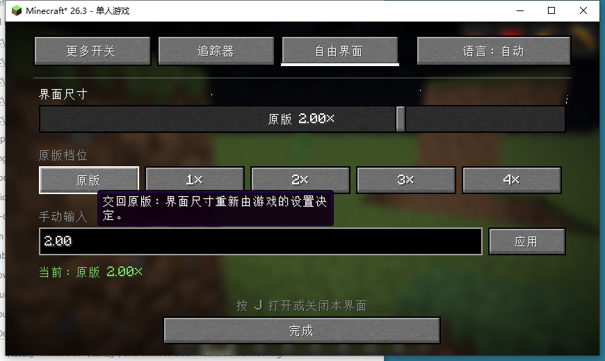

<div align="center">


# 更多开关追踪 · More Switches Tracker

**16 个实用开关 + 12 个追踪模块 + 无级界面尺寸，一个窗口三个选项卡**

Minecraft 1.21.1 / 26.3 · Fabric &amp; NeoForge · 中文 / English

[](LICENSE)
[](CHANGELOG.md)

[中文](README.md) · [English](README_EN.md)

作者 **黑山大叔** · [Bilibili](https://space.bilibili.com/19428259) · [GitHub](https://github.com/heiheids)

</div>

---

## 目录

- [这是什么](#这是什么)
- [下载哪个文件](#下载哪个文件)
- [安装](#安装)
- [打开界面](#打开界面)
- [自由界面（1.1.0 新增）](#自由界面110-新增)
- [16 个实用开关](#16-个实用开关)
- [12 个追踪模块](#12-个追踪模块)
- [追踪器指令](#追踪器指令)
- [语言](#语言)
- [配置文件](#配置文件)
- [兼容性](#兼容性)
- [从源码构建](#从源码构建)
- [项目结构](#项目结构)
- [测试状态](#测试状态)
- [已知限制](#已知限制)
- [许可](#许可)

---

## 这是什么

`更多开关追踪` 把两个原本独立的模组合并进了一个窗口：

| 原模组 | 提供的内容 |
|---|---|
| **更多开关功能** | 16 个客户端 / 服务端实用开关 |
| **追踪器** | 12 个实体、掉落物、状态追踪模块 |

合并后只保留 **J** 一个按键：打开同一个窗口，用顶部的三个选项卡切换。两边的功能、默认值、配置文件和指令全部保留 —— 不是重写，也不是把所有控件硬塞进一个巨型界面。

<p align="center">
  
  
</p>

### 1.1.0 新增：自由界面

原版只给你 1×～4× 四档整数倍率，小屏幕嫌大、大屏幕嫌小。1.1.0 在「追踪器」和语言按钮之间加了第三个选项卡 **自由界面**，可以把界面尺寸无级调到 **0.5× ～ 8×** 之间的任意值。

详见 [自由界面](#自由界面110-新增) 一节。

---

## 下载哪个文件

先确认你的游戏版本和加载器，再挑对应的 jar：

| 游戏版本 | 加载器 | 下载文件 | 需要的 Java |
|---|---|---|---|
| 1.21.1 | NeoForge 21.1.x | `moreswitchtracker-neoforge-1.21.1-1.1.0.jar` | Java 21 |
| 26.3 | NeoForge | `moreswitchtracker-neoforge-26.3-1.1.0.jar` | Java 21+ |
| 26.3 | Fabric | `moreswitchtracker-fabric-26.3-1.1.0.jar` | Java 21+ |

> **不要一次装多个。** 同一个游戏版本只放一个 jar。装错加载器的版本会直接启动失败。

---

## 安装

1. 装好对应的 Minecraft 版本和加载器。
2. 把 jar 放进 `.minecraft/mods`（整合包则放进实例的 `mods`）。
3. 启动游戏，按 **J**。

**客户端和服务端都建议安装。** 遗产追踪、玩家跨区位置、流浪商人、不消失怪物、卡顿源头、怪物透视、仇恨射线等功能带服务端逻辑；只装客户端时这些功能会退化或不可用。纯客户端功能（窗口锁定、粒子、声音、光照、自由界面等）只装客户端就能用。

---

## 打开界面

```
[ 更多开关 ] [ 追踪器 ] [ 自由界面 ]                    [ 语言：自动 ]
────────────────────────────────────────────────────────────────────
                        当前选项卡的内容
────────────────────────────────────────────────────────────────────
                    按 J 打开或关闭本界面
                              [ 完成 ]
```

- **J** 打开 / 关闭。界面不暂停单人游戏，方便盯着烟花冷却、商人倒计时这类实时状态。
- 顶部三个选项卡切换内容。
- 右上角语言按钮循环 **自动 → 中文 → English → 自动**，只改本模组的文字，不动游戏语言。
- 每个功能一个独立开关，改动立即写入配置文件。
- 鼠标滚轮滚动列表，右侧滚动条指示位置。

---

## 自由界面（1.1.0 新增）

<p align="center">
  
</p>

原版 `界面尺寸` 只有自动、1×、2×、3×、4× 五档，而且档位是整数 —— 2× 和 3× 之间没有任何东西。这个选项卡让你自己定。

### 三种调法

| 方式 | 说明 |
|---|---|
| **拖动滑块** | 0.5× ～ 8× 之间无级调整，步长 0.05×。松手才生效，拖动过程中不会反复重建界面 |
| **点原版档位** | `原版` `1×` `2×` `3×` `4×` 五个快捷按钮，对应游戏原本的档位 |
| **手动输入** | 在输入框里打数字（支持 `1.75` 这种小数），点「应用」 |

下方状态行会实时告诉你当前是多少倍率；如果请求的倍率超过窗口能承受的上限，会显示成 `请求 4.00×，实际 2.67×`。

### 上限是怎么来的

界面尺寸不能无限大，否则窗口里连一个按钮都放不下。上限取三者最小值：

```
上限 = min( 8.0, 窗口像素宽 / 320, 窗口像素高 / 180 )
```

也就是保证界面至少有 320×180 的逻辑分辨率。854×480 的窗口上限约 2.67×，1280×720 约 4.00×，1920×1080 约 6.00×。窗口越大，能调的倍率越高。

### 「原版」按钮是什么

它把尺寸决定权**交回游戏设置**：关掉自由倍率，界面尺寸重新由「视频设置 → 界面尺寸」那个原版选项决定。想彻底回到原版行为就点它。

自由倍率生效期间，原版的「界面尺寸」选项不再起作用 —— 因为它只能给整数档位。这不是 bug，是设计如此。

### 设置会保存

倍率写进配置文件，下次启动自动恢复。设成 `0` 表示不使用自由倍率（即原版行为），此时配置里不会写入这一项。

### 一点说明

非整数倍率意味着界面元素落在非整数像素上，文字边缘可能比整数倍率略软一点点 —— 这是所有非整数缩放的固有代价，换来的是尺寸自由。如果你更在意锐利度，用 `1×` `2×` 这类整数档位即可。

---

## 16 个实用开关

默认全部关闭。

| # | 开关 | 作用 |
|---|---|---|
| 1 | 锁定窗口大小 | 禁止拖拽改变窗口尺寸；窗口仍可移动 |
| 2 | 烟花火箭强制冷却 | 使用烟花后 3 秒内不能再次使用 |
| 3 | 下雨就可以睡觉 | 下雨时白天也能睡觉并跳到第二天 |
| 4 | 关闭 Q 键丢弃物品 | Q / Ctrl+Q 不再丢物品 |
| 5 | 禁用 F11 全屏 | F11 不再切换全屏；视频设置里的按钮仍可用 |
| 6 | 关闭药水粒子效果 | 隐藏药水粒子，效果本身不变 |
| 7 | 预览光照范围 | 手持光源时用青色数字显示光照等级 |
| 8 | 移动光源 | 手持光源时周围产生视觉亮度渐变 |
| 9 | 关闭资源包警告 | 不再提示版本不匹配的资源包 |
| 10 | 关闭篝火烟雾 | 篝火不再冒烟 |
| 11 | 关闭新手教程 | 不弹教程、不提醒新配方 |
| 12 | 生存使用假玩家 | 改 Carpet 配置，让 `/player` 在生存可用；需重进世界 |
| 13 | 副手自动补充图腾 | 自动从背包补不死图腾到副手 |
| 14 | 关闭爆炸声 | 去掉爆炸音效 |
| 15 | 关闭矿车声音 | 去掉矿车滚动 / 乘坐声音 |
| 16 | 关闭活塞声音 | 去掉活塞推出 / 收回声音 |

---

## 12 个追踪模块

只有 **遗产追踪** 默认开启，其余默认关闭。

| # | 开关 | 作用 |
|---|---|---|
| 1 | 遗产追踪 | 死亡点 + 掉落物高亮 5 分钟，带倒计时与损失播报 |
| 2 | 玩家追踪 | 聊天输入 `@玩家` 高亮 10 分钟，显示距离 |
| 3 | 流浪商人追踪 | 刷新提示、消失倒计时、10 分钟高亮、提示音 |
| 4 | 不消失怪物追踪 | 找出命名 / 捡过物品等永不消失的怪物 |
| 5 | 实体卡顿源头追踪 | 按实体 / 方块实体 / 区块统计 tick 开销 |
| 6 | 精英怪追踪 | 高亮高血量怪物并显示血量 |
| 7 | 折跃门追踪器 | 标记最近的末地折跃门 10 分钟 |
| 8 | 村民兴趣点追踪 | 村民到床 / 工作方块的连线 |
| 9 | 僵尸仇恨追踪 | 僵尸到攻击目标的红色连线 |
| 10 | 末影龙仇恨追踪 | 末影龙到锁定玩家的蓝色连线 |
| 11 | 自定义坐标追踪 | 输入 `x y z` 持续高亮；坐标会保存 |
| 12 | 怪物透视 | 128 格内敌对怪物获得 2 分钟发光轮廓 |

---

## 追踪器指令

```
/tracker show <id>            重新高亮某个死亡点
/tracker hide                 关闭当前死亡点高亮
/tracker list                 列出记录的死亡点
/tracker trader <uuid>        高亮指定流浪商人
/tracker lag [id]             列出 / 高亮卡顿热点
/tracker sound                试听商人提示音
/tracker elite [uuid]         列出 / 高亮精英怪
/tracker gateway              搜索末地折跃门
/tracker coord                查看并恢复已保存坐标
/tracker coord <x> <y> <z>    设置坐标并自动开启（支持 ~）
/tracker coord off            关闭高亮，保留坐标
/tracker coord clear          清除坐标
```

聊天里的坐标和编号可以直接点击执行对应指令。

---

## 语言

- 默认 **自动**：游戏是中文就显示中文，其余显示英文。
- 手动 **中文 / English** 只影响本模组的界面、开关名称、说明、按钮、提示和追踪器设置页。
- 追踪器的聊天播报和部分世界内 HUD 仍跟随 Minecraft 原版语言系统 —— 这样服务端发给不同语言玩家的消息才正常，是刻意保留的。
- 语言文件：`assets/moreswitchtracker/lang/zh_cn.json`、`en_us.json`。

---

## 配置文件

两个文件都在 `config/` 下，互不干扰：

| 文件 | 内容 |
|---|---|
| `config/moreswitches.json` | 16 个实用开关 + 语言选择 + 自由界面倍率 |
| `config/tracker.json` | 12 个追踪开关 + 自定义坐标 |

从旧版升级时，原有开关状态、语言、坐标会直接继续使用，不需要迁移。删掉对应文件即可恢复该部分默认值。

---

## 兼容性

- **Sodium / Iris**：自由界面对渲染管线的改动是 Minecraft 自己的 `Projection` 和 `Scissor` 调用，不依赖具体渲染后端，因此与光影、渲染优化模组共存。但极端情况下第三方模组若自己缓存了界面缩放值，可能出现 HUD 位置偏移 —— 遇到请反馈。
- **其他界面模组**：本模组只在 `J` 键和它自己的界面上工作，不改原版任何界面。
- **服务端**：纯客户端功能在服务器上无需安装；追踪类功能需要服务端也装。
- **Carpet**：`生存使用假玩家` 需要 Carpet 存在才会生效。

---

## 从源码构建

仓库根目录是 **1.21.1 NeoForge** 工程，另外两个版本在 `versions/` 下，各自是独立工程。

```
moreswitchtracker/
├── src/                      1.21.1 NeoForge 源码
├── build.gradle
├── versions/
│   ├── 26.3-fabric/          26.3 Fabric 源码
│   └── 26.3-neoforge/        26.3 NeoForge 源码
└── docs/
```

### 1.21.1 NeoForge（需要 JDK 21）

```bash
./gradlew build
# 产物 build/libs/moreswitchtracker-neoforge-1.21.1-1.1.0.jar
```

### 26.3 Fabric

```bash
cd versions/26.3-fabric
./gradlew build
```

### 26.3 NeoForge

```bash
cd versions/26.3-neoforge
./gradlew build
```

三个工程都需要联网下载 Minecraft 与加载器依赖，首次构建较慢。

> **提示**：26.3 NeoForge 的 `createMinecraftArtifacts` 在部分环境（JDK 25 + Windows）会失败。如果卡在这一步，可以先用 `./gradlew createMinecraftArtifacts` 单独生成中间产物，再用 `javac` 直接编译 `src/main/java`，最后手工打包 jar。本仓库的三个发布 jar 中，26.3 NeoForge 就是用这种方式产出的。

---

## 项目结构

```
src/main/java/com/heishandashu/
├── moreswitches/                 更多开关的一半
│   ├── client/ui/                窗口外壳 + 三个选项卡
│   │   ├── MergedSettingsScreen.java
│   │   ├── SettingsTab.java
│   │   ├── SwitchesSettingsTab.java
│   │   ├── TrackerSettingsTab.java
│   │   ├── FreeGuiScaleTab.java          ← 自由界面
│   │   └── GuiScaleSlider.java           ← 无级滑块
│   ├── client/gui/               自由界面的尺寸状态机
│   │   ├── FreeGuiScale.java             倍率、上下限、窗口适配
│   │   └── GuiScaleApplier.java          把改动推迟到下一个 tick 统一应用
│   ├── config/                   开关清单与 moreswitches.json
│   ├── i18n/                     中英双语表
│   └── client/feature/           16 个开关模块
└── tracker/                      追踪器的一半（保留原模块边界）
    ├── module/                   12 个服务端 / 公共模块
    ├── client/module/            客户端渲染与状态
    ├── net/                      7 条 payload 通道
    └── compat/                   加载器事件胶水层
```

一个功能一个模块；窗口外壳、选项卡和共享控件各自独立，没有单文件海量代码。

---

## 测试状态

诚实说明每个版本的验证程度：

| 版本 | 编译 | 真机运行 |
|---|---|---|
| 26.3 Fabric | ✅ | ✅ 全部选项卡与自由界面的滑块、档位、手动输入、重启恢复均已实测 |
| 26.3 NeoForge | ✅ | ⚠️ 与 Fabric 共用同一份客户端代码，未逐项实测 |
| 1.21.1 NeoForge | ✅ | ⚠️ 自由界面的 mixin 路径不同，未逐项实测 |

遇到问题请带上 `logs/latest.log` 提 issue。

---

## 已知限制

- 追踪器的聊天播报 / 世界 HUD 文字跟随游戏语言，不跟手动语言按钮。
- 卡顿源头统计需要服务端配合，且要进入世界后等待一个统计窗口。
- 折跃门只搜索已加载区块。
- 纯客户端服务器上，玩家追踪只能看到客户端已加载的玩家。
- 自由界面的上限受窗口尺寸限制，见 [上限是怎么来的](#上限是怎么来的)。
- 26.3 的物品图标仍按取整后的整数倍率绘制，非整数倍率下可能比文字略微错位。

---

## 许可

[MIT](LICENSE) © 黑山大叔
