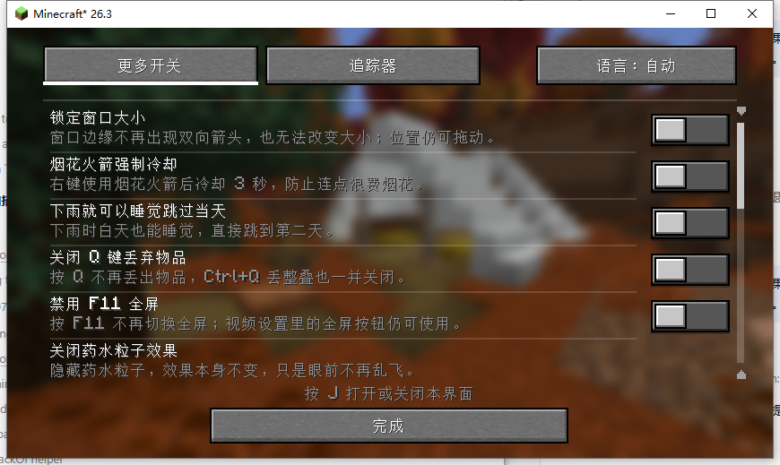
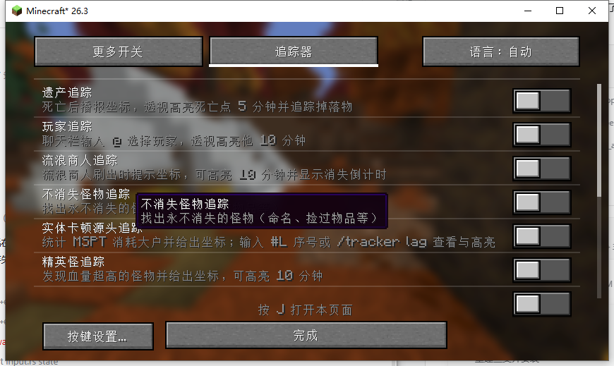
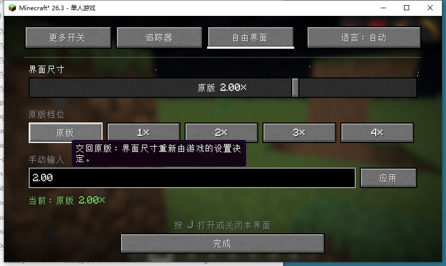

<div align="center">


# More Switches Tracker

**16 quality-of-life toggles + 12 tracking modules + free-form GUI scale, one window, three tabs**

Minecraft 1.21.1 / 26.3 · Fabric &amp; NeoForge · English / 中文

[](LICENSE)
[](CHANGELOG.md)

[中文](README.md) · [English](README_EN.md)

By **黑山大叔 (Heishan Dashu)** · [Bilibili](https://space.bilibili.com/19428259) · [GitHub](https://github.com/heiheids)

</div>

---

## Contents

- [What this is](#what-this-is)
- [Which file to download](#which-file-to-download)
- [Installation](#installation)
- [Opening the window](#opening-the-window)
- [Free GUI scale (new in 1.1.0)](#free-gui-scale-new-in-110)
- [The 16 toggles](#the-16-toggles)
- [The 12 tracking modules](#the-12-tracking-modules)
- [Tracker commands](#tracker-commands)
- [Language](#language)
- [Config files](#config-files)
- [Compatibility](#compatibility)
- [Building from source](#building-from-source)
- [Project layout](#project-layout)
- [Testing status](#testing-status)
- [Known limitations](#known-limitations)
- [License](#license)

---

## What this is

`More Switches Tracker` merges two previously separate mods into a single window:

| Original mod | What it provides |
|---|---|
| **More Switches** | 16 client/server quality-of-life toggles |
| **Tracker** | 12 modules that highlight entities, drops and world state |

After the merge there is exactly one key, **J**: it opens one window, and the three tabs at the top switch between the two halves. Every feature, default value, config file and command from both mods is preserved — nothing was rewritten, and nothing was crammed into one giant screen.

<p align="center">
  
  
</p>

### New in 1.1.0: free GUI scale

Vanilla only offers four integer steps, 1× to 4×. Too big on a small screen, too small on a large one. 1.1.0 adds a third tab, **Free GUI scale**, between *Tracker* and the language button, that lets you pick any value from **0.5× to 8×**.

See [Free GUI scale](#free-gui-scale-new-in-110).

---

## Which file to download

Check your game version and loader, then pick the matching jar:

| Game version | Loader | File | Java |
|---|---|---|---|
| 1.21.1 | NeoForge 21.1.x | `moreswitchtracker-neoforge-1.21.1-1.1.0.jar` | Java 21 |
| 26.3 | NeoForge | `moreswitchtracker-neoforge-26.3-1.1.0.jar` | Java 21+ |
| 26.3 | Fabric | `moreswitchtracker-fabric-26.3-1.1.0.jar` | Java 21+ |

> **Install only one.** Never put two of these in the same `mods` folder. A jar built for the wrong loader will fail to start.

---

## Installation

1. Install the matching Minecraft version and loader.
2. Drop the jar into `.minecraft/mods` (or the instance's `mods` folder).
3. Start the game and press **J**.

**Installing on both client and server is recommended.** Legacy tracking, cross-dimension player positions, wandering traders, persistent mobs, lag sources, mob ESP and aggro lines all involve server-side logic; client-only installs will degrade or disable those features. Purely client-side features (window lock, particles, sounds, light overlay, free GUI scale, …) work with a client-only install.

---

## Opening the window

```
[ Switches ] [ Tracker ] [ Free GUI scale ]              [ Language: Auto ]
──────────────────────────────────────────────────────────────────────────
                        contents of the current tab
──────────────────────────────────────────────────────────────────────────
                  Press J to open or close this window
                                [ Done ]
```

- **J** opens and closes. The window does **not** pause single-player, so you can watch firework cooldowns or trader countdowns live.
- Three tabs at the top switch the contents.
- The language button cycles **Auto → 中文 → English → Auto**. It only changes this mod's text, never the game language.
- One independent switch per feature; changes are saved immediately.
- Scroll wheel scrolls the list, with a scrollbar on the right.

---

## Free GUI scale (new in 1.1.0)

<p align="center">
  
</p>

Vanilla's *GUI Scale* option has five choices — Auto, 1×, 2×, 3×, 4× — and they are all integers. There is nothing between 2× and 3×. This tab lets you choose for yourself.

### Three ways to set it

| Method | Behaviour |
|---|---|
| **Drag the slider** | Any value from 0.5× to 8× in 0.05× steps. It commits when you release, so dragging never rebuilds the screen repeatedly |
| **Click a vanilla preset** | `Vanilla` `1×` `2×` `3×` `4×`, matching the game's own steps |
| **Type a number** | Enter a value in the field (decimals such as `1.75` are fine) and press **Apply** |

A status line below shows the current scale. If the value you asked for exceeds what the window can support, it reports both: `requested 4.00×, actual 2.67×`.

### Where the cap comes from

The scale cannot grow forever, or a single button would no longer fit on screen. The cap is the smallest of three values:

```
cap = min( 8.0, window width in px / 320, window height in px / 180 )
```

In other words the GUI always keeps at least a 320×180 logical resolution. An 854×480 window caps out near 2.67×, 1280×720 near 4.00×, and 1920×1080 near 6.00×. The bigger the window, the further you can push it.

### What the "Vanilla" button does

It hands sizing back to the game: the free scale is switched off and the GUI size is decided by the vanilla *Video Settings → GUI Scale* option again. Click it when you want the stock behaviour back.

While a free scale is active, the vanilla GUI Scale option has no effect — it can only express integer steps. That is by design, not a bug.

### It persists

The scale is written to the config file and restored on the next launch. A value of `0` means "free scale off" (i.e. vanilla behaviour); in that case the key is not written at all.

### One caveat

A non-integer scale puts GUI elements on fractional pixels, so text edges can look very slightly softer than at integer scales. That is the inherent cost of any fractional scaling, and it is what buys you the freedom. If sharpness matters more to you, stick to integer steps such as `1×` or `2×`.

---

## The 16 toggles

All off by default.

| # | Toggle | Effect |
|---|---|---|
| 1 | Lock window size | Dragging can no longer resize the window; it can still be moved |
| 2 | Firework rocket cooldown | Cannot use another rocket for 3 seconds after one |
| 3 | Sleep when raining | Sleep during the day while it rains and skip to the next day |
| 4 | Disable Q drop | Q / Ctrl+Q no longer drop items |
| 5 | Disable F11 fullscreen | F11 no longer toggles fullscreen; the button in Video Settings still works |
| 6 | Hide potion particles | Hides potion particles; the effect itself is unchanged |
| 7 | Light level preview | Shows the light level in cyan while holding a light source |
| 8 | Dynamic light | Adds a visual brightness gradient around a held light source |
| 9 | Disable resource pack warning | No more "made for a different version" prompts |
| 10 | Disable campfire smoke | Campfires stop smoking |
| 11 | Disable tutorial | No tutorial pop-ups or new-recipe reminders |
| 12 | Survival fake players | Edits the Carpet config so `/player` works in survival; rejoin the world to apply |
| 13 | Auto-refill totem | Moves a totem of undying from your inventory into the offhand |
| 14 | Mute explosions | Removes explosion sounds |
| 15 | Mute minecarts | Removes minecart rolling / riding sounds |
| 16 | Mute pistons | Removes piston extend / retract sounds |

---

## The 12 tracking modules

Only **Legacy tracking** is on by default; the rest are off.

| # | Toggle | Effect |
|---|---|---|
| 1 | Legacy tracking | Highlights your death point and drops for 5 minutes, with a countdown and a loss report |
| 2 | Player tracking | Type `@name` in chat to highlight that player for 10 minutes, with distance |
| 3 | Wandering trader tracking | Spawn notice, despawn countdown, 10-minute highlight, chime |
| 4 | Persistent mob tracking | Finds mobs that never despawn (named, picked up items, …) |
| 5 | Lag source tracking | Tick cost per entity / block entity / chunk |
| 6 | Elite mob tracking | Highlights high-health mobs and shows their health |
| 7 | End gateway tracking | Marks the nearest end gateway for 10 minutes |
| 8 | Villager POI tracking | Lines from villagers to their bed / workstation |
| 9 | Zombie aggro tracking | Red line from a zombie to its attack target |
| 10 | Ender dragon aggro tracking | Blue line from the dragon to the player it locked onto |
| 11 | Custom coordinate tracking | Enter `x y z` to highlight it persistently; the coordinates are saved |
| 12 | Mob ESP | Hostile mobs within 128 blocks get a glowing outline for 2 minutes |

---

## Tracker commands

```
/tracker show <id>            re-highlight a death point
/tracker hide                 stop highlighting the current death point
/tracker list                 list recorded death points
/tracker trader <uuid>        highlight a specific wandering trader
/tracker lag [id]             list / highlight lag hotspots
/tracker sound                preview the trader chime
/tracker elite [uuid]         list / highlight elite mobs
/tracker gateway              search for an end gateway
/tracker coord                show and restore saved coordinates
/tracker coord <x> <y> <z>    set coordinates and enable (supports ~)
/tracker coord off            stop highlighting, keep the coordinates
/tracker coord clear          clear the coordinates
```

Coordinates and ids printed in chat are clickable and run the matching command.

---

## Language

- **Auto** by default: Chinese if the game is Chinese, English otherwise.
- Manual **中文 / English** only affects this mod's screens, toggle names, descriptions, buttons, tooltips and the tracker settings page.
- Tracker chat messages and some in-world HUD text still follow Minecraft's own language system, so messages the server sends to players in different languages keep working. This is deliberate.
- Language files: `assets/moreswitchtracker/lang/zh_cn.json`, `en_us.json`.

---

## Config files

Two files under `config/`, independent of each other:

| File | Contents |
|---|---|
| `config/moreswitches.json` | the 16 toggles + language choice + free GUI scale |
| `config/tracker.json` | the 12 tracking toggles + custom coordinates |

Upgrading from an older version keeps your switch states, language and coordinates — no migration needed. Delete a file to restore that half's defaults.

---

## Compatibility

- **Sodium / Iris**: the free-scale renderer hooks Minecraft's own `Projection` and `Scissor` calls rather than a specific backend, so it coexists with shaders and render-optimisation mods. In rare cases a third-party mod that caches the GUI scale itself may show slightly offset HUD elements — please report it if you hit that.
- **Other GUI mods**: this mod only touches the `J` key and its own screens; vanilla screens are untouched.
- **Servers**: purely client-side features need no server install; tracking features do.
- **Carpet**: *Survival fake players* only works when Carpet is present.

---

## Building from source

The repository root is the **1.21.1 NeoForge** project; the other two versions live under `versions/` as independent projects.

```
moreswitchtracker/
├── src/                     1.21.1 NeoForge sources
├── build.gradle
├── versions/
│   ├── 26.3-fabric/         26.3 Fabric sources
│   └── 26.3-neoforge/       26.3 NeoForge sources
└── docs/
```

### 1.21.1 NeoForge (JDK 21)

```bash
./gradlew build
# output: build/libs/moreswitchtracker-neoforge-1.21.1-1.1.0.jar
```

### 26.3 Fabric

```bash
cd versions/26.3-fabric
./gradlew build
```

### 26.3 NeoForge

```bash
cd versions/26.3-neoforge
./gradlew build
```

All three need network access to download Minecraft and loader dependencies; the first build is slow.

> **Note**: on some setups (JDK 25 + Windows) the 26.3 NeoForge `createMinecraftArtifacts` task fails. If you get stuck there, run `./gradlew createMinecraftArtifacts` on its own to produce the intermediate artifacts, then compile `src/main/java` with `javac` and package the jar by hand. That is how the 26.3 NeoForge release jar in this repository was produced.

---

## Project layout

```
src/main/java/com/heishandashu/
├── moreswitches/                 the "more switches" half
│   ├── client/ui/                window shell + the three tabs
│   │   ├── MergedSettingsScreen.java
│   │   ├── SettingsTab.java
│   │   ├── SwitchesSettingsTab.java
│   │   ├── TrackerSettingsTab.java
│   │   ├── FreeGuiScaleTab.java          ← free GUI scale tab
│   │   └── GuiScaleSlider.java           ← the continuous slider
│   ├── client/gui/               free-scale state machine
│   │   ├── FreeGuiScale.java             scale, bounds, window fitting
│   │   └── GuiScaleApplier.java          defers changes to the next tick
│   ├── config/                   toggle list and moreswitches.json
│   ├── i18n/                     bilingual text table
│   └── client/feature/           the 16 toggle modules
└── tracker/                      the tracker half (original module boundaries kept)
    ├── module/                   the 12 server / common modules
    ├── client/module/            client rendering and state
    ├── net/                      7 payload channels
    └── compat/                   loader event glue
```

One feature per module; the window shell, the tabs and the shared widgets are all separate, with no single enormous file.

---

## Testing status

An honest account of how much each build has been verified:

| Build | Compiles | Run in a real client |
|---|---|---|
| 26.3 Fabric | ✅ | ✅ every tab, plus the free-scale slider, presets, manual input and restart persistence |
| 26.3 NeoForge | ✅ | ⚠️ shares the same client code as Fabric, not exercised item by item |
| 1.21.1 NeoForge | ✅ | ⚠️ free scale uses a different mixin path, not exercised item by item |

If something breaks, please open an issue with `logs/latest.log` attached.

---

## Known limitations

- Tracker chat messages and in-world HUD text follow the game language, not the language button.
- Lag-source statistics need server cooperation and one full sampling window after joining a world.
- End gateway search only covers loaded chunks.
- On a fully client-side server, player tracking only sees players the client has loaded.
- The free GUI scale is capped by window size, see [Where the cap comes from](#where-the-cap-comes-from).
- On 26.3, item icons are still drawn at the rounded integer scale, so they can be very slightly misaligned against text at fractional scales.

---

## License

[MIT](LICENSE) © 黑山大叔
